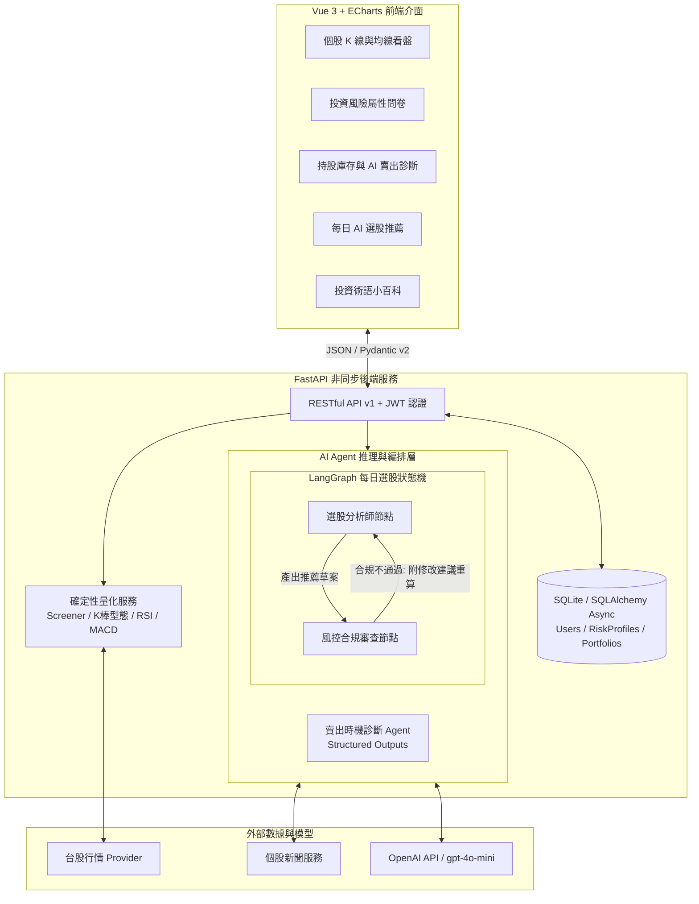

# 📈 台股量化分析與 Multi-Agent AI 投顧系統 (TW-Stock Quantitative & Agentic Advisory System)

一個結合**確定性量化特徵工程（Deterministic Feature Engineering）**、**LangGraph 多代理人狀態機編排（Multi-Agent Reflection Loop）**與**來源溯源防幻覺機制（Citation Grounding）**的企業級台股投資輔助系統。

---

## 🎯 專案解決的核心痛點

傳統 LLM 應用在金融領域常面臨三大致命缺陷：**數學計算不精準、憑空捏造新聞與數據（幻覺）、以及缺乏個人化風控邊界**。本系統透過以下架構設計徹底解決這些問題：

1. **確定性量化與機率性推理分離（Hybrid Architecture）：**
   - 均線（MA5/20/60）、K 棒型態（實體比例、上下影線）、量比倍數、14 日 RSI 與 MACD 均由純 Python 確定性演算法計算，絕不交由 LLM 自行推算。
   - LLM 專注於語意理解財經新聞、整合多維度技術指標，並根據用戶風險畫像進行邏輯推理。
2. **LangGraph 雙代理人自我修正迴圈（Reflection Pattern）：**
   - 導入 `Analyst Agent（選股分析師）` 與 `Risk Auditor Agent（風控合規審查員）` 狀態機。若推薦標的違反用戶停損上限或在 RSI 超買區追高，系統會自動附上審查意見退回重算。
3. **強制結構化輸出與來源溯源（Pydantic v2 + Citation Grounding）：**
   - 所有 AI 決策均透過 OpenAI Structured Outputs 鎖定 Pydantic v2 Schema，強制輸出 `SourceReference`（可點擊查證的新聞 URL 與真實技術指標數值），確保每筆買賣建議有據可查。

---

## 🏗️ 系統整體架構圖



---

## ✨ 核心功能模組

* **🔐 用戶認證與風險畫像（Auth & Risk Profiling）：** 採用 JWT 與 Bcrypt 雜湊認證；透過 5 題量化金融問卷動態評估用戶為「保守型 / 穩健型 / 積極型」，並綁定個人化目標報酬率與最大可承受虧損（Max Drawdown）。
* **📊 庫存診斷與賣出策略 Agent（Sell Advisor Agent）：** 結合用戶買進成本、即時損益、K 棒型態（如長上影線遇壓、帶量長紅）、RSI/MACD 動能與最新個股新聞，給出分批停利、續抱波段或停損建議，並附上可驗證來源。
* **🤖 每日買進清單 Multi-Agent（LangGraph Recommender）：** 先由量化初篩器過濾資金預算與均線強弱，再由「分析師 + 風控審查員」狀態機精選 3 檔最適合該用戶的標的，提供進場區間、建議股數試算與停損停利價位。
* **📚 金融專業術語知識庫（Glossary Service）：** 內建台股與技術分析術語庫，支援分類檢索與白話實戰解析，降低新手判讀門檻。

---

## 🛠️ 技術棧與工程規範 (Tech Stack & Engineering Standards)

* **後端框架：** Python 3.11+、FastAPI、SQLAlchemy (Async)、Pydantic v2
* **AI 編排與模型：** OpenAI SDK (`Structured Outputs`)、LangGraph (`StateGraph`)
* **數據處理：** Pandas、NumPy
* **前端框架：** Vue 3 (Composition API)、ECharts
* **品質把關與測試：** Ruff（靜態程式碼檢查）、Pytest（全模組自動化單元測試與 Mock 外部 API 隔離）
* **AI 輔助開發規範：** 專案根目錄維護 `AGENTS.md`，落實 Spec-Driven Development（規格驅動開發）與自動化驗證迴圈。

---

## 🚀 本地啟動指南 (Quick Start)

### 1. 環境變數設定
複製專案根目錄的範本檔案並填入你的 OpenAI API 金鑰：
```bash
cp .env.example .env
# 編輯 .env 填入 OPENAI_API_KEY=sk-proj-xxxx
```

### 2. 啟動後端服務 (FastAPI)
```bash
python -m venv .venv
# Windows 啟動虛擬環境：.venv\Scripts\activate
# macOS/Linux 啟動虛擬環境：source .venv/bin/activate

pip install -r backend/requirements.txt
uvicorn app.main:app --app-dir backend --reload
```

### 3. 啟動前端服務 (Vue 3)
```bash
cd frontend
npm install
npm run dev
```

### 4. 執行自動化測試與程式碼檢查
```bash
ruff check backend/
pytest backend/tests/
```